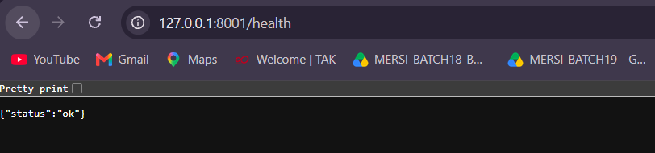
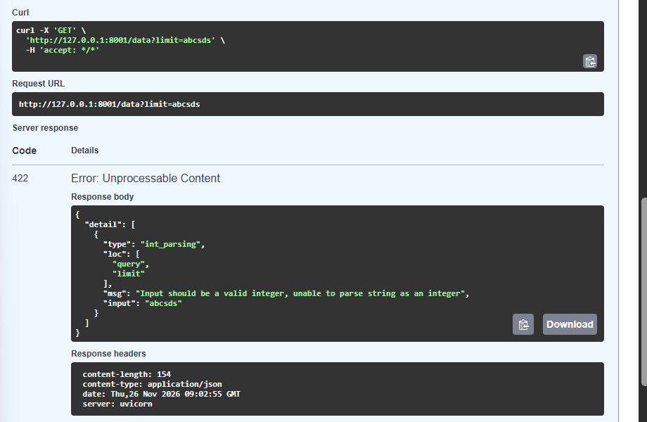
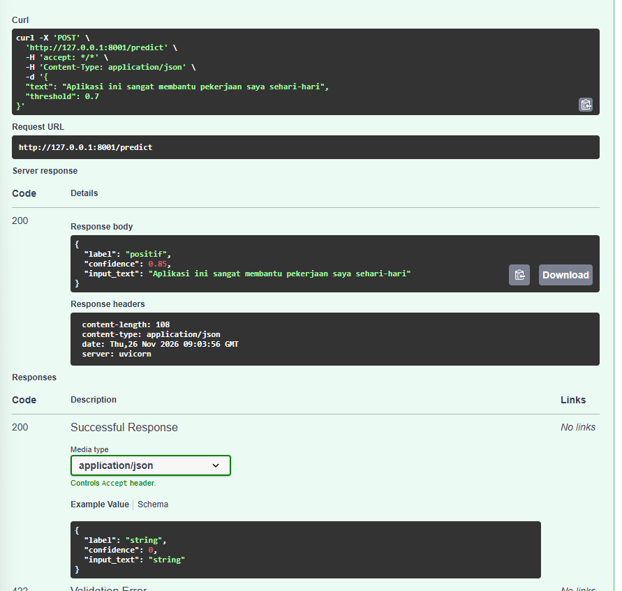
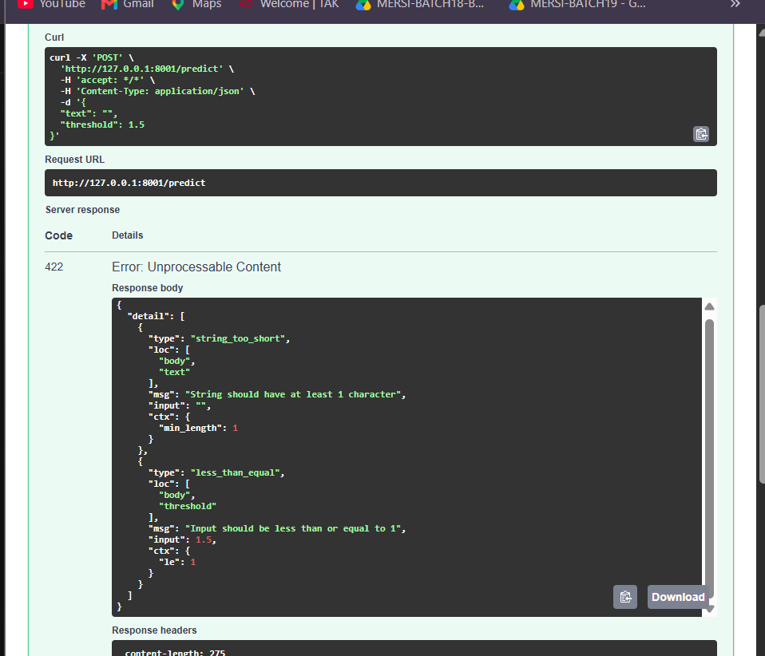

# AI Prediction API

API sederhana yang dibuat dengan **FastAPI** sebagai latihan Bootcamp AI Engineer. API ini punya tiga endpoint: pengecekan status server, pengambilan data dummy dengan filter, dan prediksi label dari teks (hasilnya masih dummy, belum memakai model sungguhan).

FastAPI juga membuat dokumentasi interaktif (Swagger UI) secara otomatis, sehingga setiap endpoint bisa dicoba langsung dari browser.

## Daftar isi

1. [Fitur](#fitur)
2. [Struktur folder](#struktur-folder)
3. [Cara menjalankan](#cara-menjalankan)
4. [Ringkasan endpoint](#ringkasan-endpoint)
5. [GET /health](#1-get-health)
6. [GET /data](#2-get-data)
7. [POST /predict](#3-post-predict)
8. [Dokumentasi Swagger](#4-dokumentasi-swagger)

## Fitur

- Endpoint `/health` untuk memastikan server berjalan.
- Endpoint `/data` dengan filter opsional `category` dan `limit`.
- Endpoint `/predict` dengan validasi body JSON (Pydantic).
- Input yang tidak valid ditolak otomatis oleh FastAPI dengan kode **422**.
- Dokumentasi Swagger lengkap dengan judul, versi, tag, summary, dan contoh payload.

## Struktur folder

```
API/
├── main.py            # kode API
├── requirements.txt   # daftar library
├── README.md          # dokumentasi ini
└── screenshots/       # bukti pengujian
```

## Cara menjalankan

1. Install library:

   ```
   pip install -r requirements.txt
   ```

2. Jalankan server (port 8001 dipakai supaya tidak bentrok dengan aplikasi lain di port 8000):

   ```
   uvicorn main:app --reload --port 8001
   ```

3. Buka di browser:
   - API: `http://127.0.0.1:8001`
   - Dokumentasi Swagger: `http://127.0.0.1:8001/docs`

Untuk menghentikan server, tekan `Ctrl + C` di terminal.

## Ringkasan endpoint

| Method | Path | Tag | Fungsi |
| --- | --- | --- | --- |
| GET | `/health` | System | Cek status server |
| GET | `/data` | Data | Ambil daftar data dummy, bisa difilter |
| POST | `/predict` | Prediction | Prediksi label dari teks |

---

## 1. GET /health

Endpoint paling sederhana. Dipakai untuk memastikan server hidup. Tidak butuh parameter dan selalu mengembalikan JSON berikut:

```json
{ "status": "ok" }
```

Hasil di browser (`http://127.0.0.1:8001/health`):



Endpoint yang sama di Swagger UI, terdaftar di bawah tag **System** dan menghasilkan kode 200:


---

## 2. GET /data

Mengembalikan daftar data dummy (6 item dengan field `id`, `category`, dan `name`). Ada dua parameter query yang keduanya opsional:

| Parameter | Tipe | Keterangan |
| --- | --- | --- |
| `category` | string | Hanya tampilkan data dengan kategori ini (misalnya `electronics`) |
| `limit` | integer (minimal 1) | Batasi jumlah data yang dikembalikan |

FastAPI memeriksa tipe parameter secara otomatis. Jika `limit` bukan angka, request ditolak tanpa perlu kode pengecekan tambahan.

### Tanpa parameter

`GET /data` mengembalikan semua data.


### Dengan filter

`GET /data?category=electronics&limit=2` hanya mengembalikan 2 item berkategori `electronics` (Laptop dan Smartphone).


### Input tidak valid (kasus negatif)

`GET /data?limit=abcsds` ditolak dengan kode **422 Unprocessable Content**, karena `abcsds` tidak bisa diubah menjadi angka. Pesan error `int_parsing` menjelaskan penyebabnya.



---

## 3. POST /predict

Menerima teks lalu mengembalikan label prediksi. Hasilnya **dummy**: nilai `confidence` selalu 0.85, dan label ditentukan dengan membandingkannya dengan `threshold`.

Body request (divalidasi oleh Pydantic):

| Field | Tipe | Aturan |
| --- | --- | --- |
| `text` | string | Panjang 1 sampai 500 karakter |
| `threshold` | float | Nilai 0.0 sampai 1.0 |

Aturan label: jika `confidence` lebih besar atau sama dengan `threshold`, label adalah `positif`. Jika tidak, label adalah `tidak yakin`.

Contoh request:

```json
{
  "text": "Aplikasi ini sangat membantu pekerjaan saya sehari-hari",
  "threshold": 0.7
}
```

Contoh response (kode 200):

```json
{
  "label": "positif",
  "confidence": 0.85,
  "input_text": "Aplikasi ini sangat membantu pekerjaan saya sehari-hari"
}
```

### Body valid



### Body tidak valid

Body `{"text": "", "threshold": 1.5}` ditolak dengan kode **422**. Ada dua error sekaligus: `text` terlalu pendek (minimal 1 karakter) dan `threshold` melebihi 1.



---

## 4. Dokumentasi Swagger

Dokumentasi di `/docs` dirapikan agar terlihat seperti spesifikasi produk:

- Judul **AI Prediction API** dengan versi **1.0.0** dan deskripsi singkat.
- Endpoint dikelompokkan dalam tiga tag: **System**, **Data**, dan **Prediction**.
- Setiap endpoint punya summary, dan `/predict` punya deskripsi tambahan.
- Request body `/predict` menampilkan contoh payload yang valid (lewat `json_schema_extra`).


## Teknologi

- Python
- FastAPI
- Uvicorn
- Pydantic
