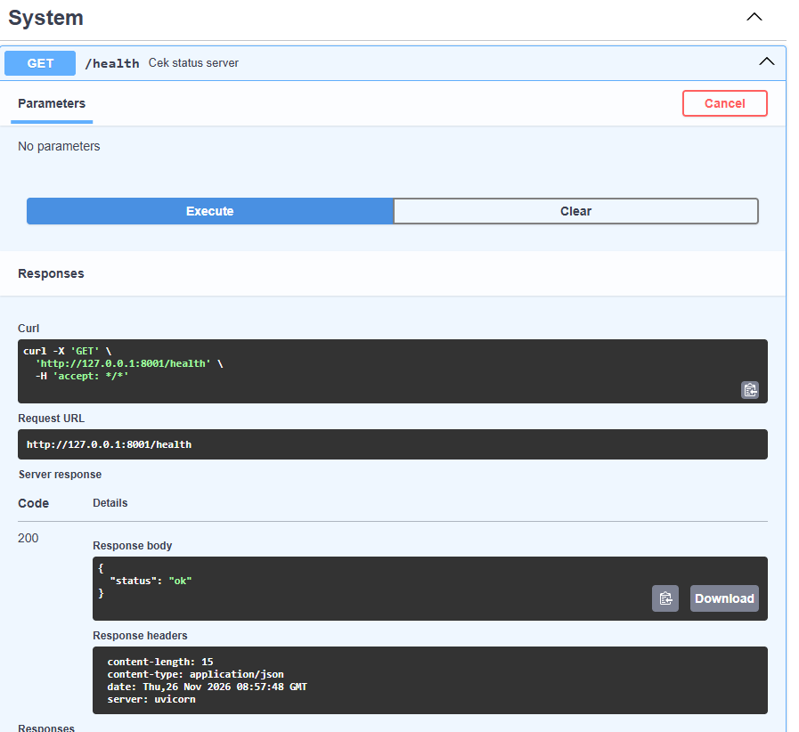
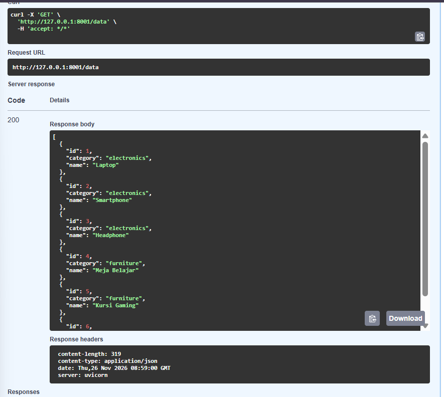
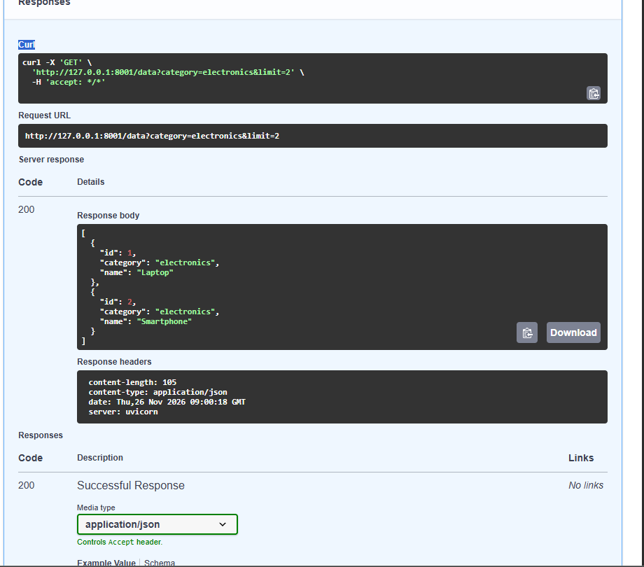
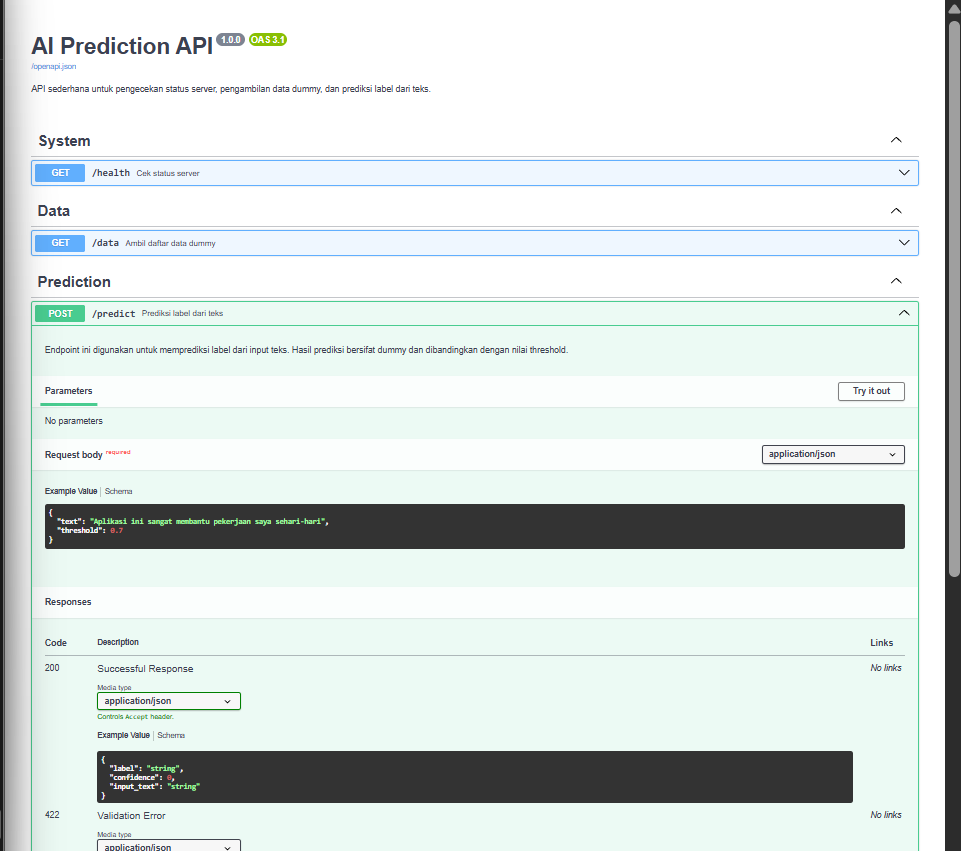

# AI Prediction API

API sederhana dengan FastAPI untuk pengecekan status server, pengambilan data dummy, dan prediksi label dari teks.

## Cara menjalankan

```
pip install -r requirements.txt
uvicorn main:app --reload --port 8001
```

Dokumentasi Swagger tersedia di `http://127.0.0.1:8001/docs`.

## Endpoint

| Method | Path | Keterangan |
| --- | --- | --- |
| GET | /health | Cek status server |
| GET | /data | Ambil data dummy, query opsional `category` dan `limit` |
| POST | /predict | Prediksi label dari teks (`text` 1-500 karakter, `threshold` 0.0-1.0) |

## Hasil pengujian

### 1. GET /health




### 2. GET /data

Tanpa parameter:



Dengan `category=electronics&limit=2`:



Dengan `limit=abcsds` (input tidak valid, kode 422):


### 3. POST /predict

Body valid (kode 200):


Body tidak valid (kode 422):


### 4. Dokumentasi Swagger


